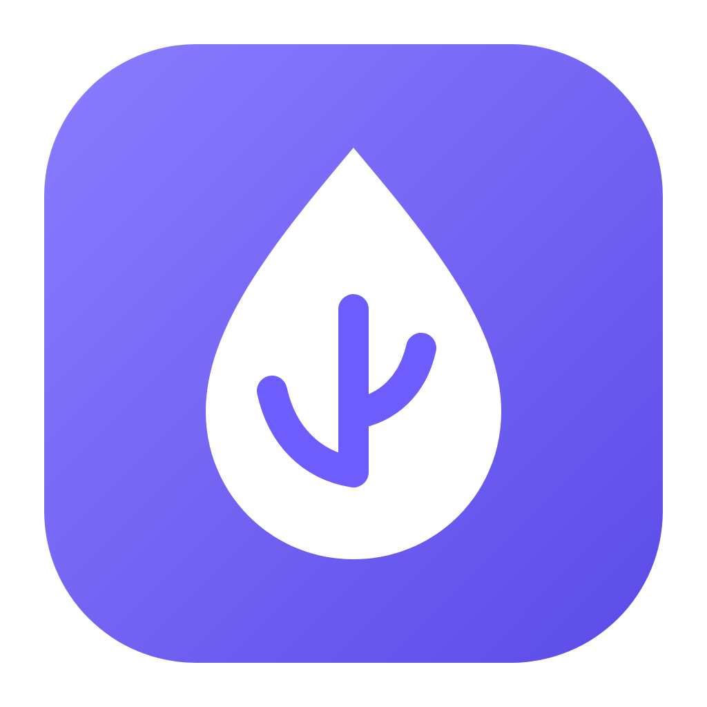
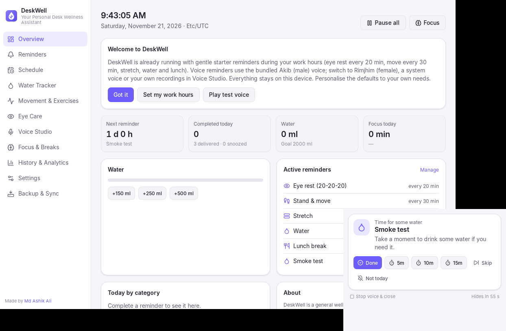

<p align="center"></p>

<h1 align="center">DeskWell</h1>
<p align="center"><b>Your Personal Desk Wellness Assistant</b><br>
Free, open-source reminders to drink water, stand up, move, rest your eyes and stretch, with friendly voice reminders in Bangla and English.<br>
Windows · macOS · Chrome</p>

<p align="center">Made by <a href="https://www.linkedin.com/in/mdashikali/"><b>Md Ashik Ali</b></a> · MIT licensed · no account, no ads, no tracking</p>

<p align="center"></p>

---

## Download

Go to the **[Releases page](https://github.com/tlakib/deskwell/releases/latest)** and pick the file for your computer:

| You use | Download | Then |
|---|---|---|
| **Windows 10/11 (recommended)** | **[Microsoft Store](https://apps.microsoft.com/detail/9PBZJ6MR67FB)** | Click **Get**. The Store version is signed by Microsoft, so it also installs on PCs with **Smart App Control** turned on. (In Store review from 21 Nov 2026; the link works once it's approved.) |
| **Windows 10/11 (direct)** | `DeskWell_x.y.z_x64-setup.exe` (or the `.msi`) | Run it. SmartScreen may say "Windows protected your PC": click **More info → Run anyway**. This unsigned build is blocked on PCs with Smart App Control on; use the Store there. |
| **macOS (Apple Silicon M1–M4)** | `DeskWell_x.y.z_aarch64.dmg` | Open the dmg and drag DeskWell to Applications. The build is unsigned: the first time, **right-click DeskWell → Open → Open**. |
| **macOS (Intel)** | `DeskWell_x.y.z_x64.dmg` | Same as above. |
| **Google Chrome** | `deskwell-extension-x.y.z.zip` | Unzip it, open `chrome://extensions`, turn on **Developer mode**, click **Load unpacked** and choose the unzipped folder. |

### Or install from the terminal

**Windows** from the Microsoft Store (works with Smart App Control; live once Store review finishes):

```powershell
winget install --id 9PBZJ6MR67FB --source msstore
```

Or the DeskWell script (PowerShell, no admin needed), which uses the Store and falls back to the GitHub installer:

```powershell
irm https://raw.githubusercontent.com/tlakib/deskwell/main/scripts/install.ps1 | iex
```

**macOS** (Terminal, picks Apple Silicon or Intel automatically):

```bash
curl -fsSL https://raw.githubusercontent.com/tlakib/deskwell/main/scripts/install.sh | bash
```

Want the Chrome extension too? On Windows run `$env:DESKWELL_CHROME = "1"` first; on macOS add `-s -- --chrome` after `bash`. The script downloads it to a folder and tells you where; Chrome only allows unpacked extensions to be added by hand (Developer mode → Load unpacked), which takes a few seconds.

After installing, DeskWell lives in your **system tray** (Windows, bottom-right, maybe under the `^` arrow) or **menu bar** (macOS, top-right). Click the icon for the quick panel; right-click for the menu. Closing the dashboard window keeps DeskWell running; use **Exit** in the tray menu to quit.

The Chrome extension only reminds you while Chrome is running. Use the desktop app if you want reminders all the time.

## What it does

- **Reminders** for water, standing, walking, eye rest (20-20-20), stretching, posture, breathing, short rests, meals and anything custom.
- **Your schedule**: every N minutes, fixed times, specific dates or once; weekdays; work hours with breaks (also night shifts across midnight); quiet hours; start/end dates.
- **Popup + voice + notification**, per reminder: Done, Snooze (your own snooze times), Skip, Not today.
- **Voices that work offline**: two bundled voice packs recorded with ElevenLabs, **Akib (male)** and **Rimjhim (female)**, in Bangla and English. You can also use your computer's own voices or upload your own recordings.
- **Focus and meeting mode**, **pause**, **water tracker** with daily goal, **history and simple stats**, CSV export.
- **Backup and restore** (JSON with a SHA-256 integrity check), optional automatic daily backups on desktop.
- Light and dark theme, 12/24-hour time, English, Bangla and German messages.

Your system clock and timezone are always the source of truth. If your computer was asleep, DeskWell doesn't fire a burst of old reminders; it simply continues from now.

**Privacy.** Everything stays on your device. DeskWell never records keystrokes, screens, clipboard or browsing, and nothing is uploaded anywhere.

**Health note.** DeskWell is a general wellness and habit tool. It does not diagnose, treat or prevent any medical condition. The default intervals are friendly starting points; change them to suit you.

## Build it yourself

Prerequisites: **Node.js 22**, **pnpm 10** (`corepack enable`), **Rust (stable)** and the [Tauri 2 prerequisites](https://v2.tauri.app/start/prerequisites/) for your OS.

```bash
pnpm install
pnpm test            # domain + extension unit tests
pnpm typecheck
pnpm dev:desktop     # run the desktop app in development
pnpm build:desktop   # build installers for the current OS (apps/desktop/src-tauri/target/release/bundle)
pnpm build:ext       # build the Chrome extension (apps/extension/dist) and zip (apps/extension/release)
pnpm --filter @deskwell/desktop test:rust   # Rust scheduler + database tests
```

Releases: push a tag such as `v0.1.0` and the **Release** GitHub Action builds the Windows installer on a Windows runner, both macOS dmgs on a macOS runner and the Chrome zip, and attaches them to a GitHub Release. See [docs/RELEASING.md](docs/RELEASING.md) for signing and notarization.

### Troubleshooting

- **Windows build:** install "Desktop development with C++" from Visual Studio Build Tools and the WebView2 runtime (preinstalled on Windows 11). Run builds from a normal terminal, not WSL.
- **macOS build:** install Xcode Command Line Tools (`xcode-select --install`). To build for Intel on Apple Silicon, `rustup target add x86_64-apple-darwin`.
- **Linux (development only):** `libwebkit2gtk-4.1-dev libappindicator3-dev librsvg2-dev`.
- **No voice?** Check the master volume in Settings and that the reminder's delivery includes voice. Use **Test voice** in the tray panel.
- **No notifications on macOS/Windows?** Allow notifications for DeskWell in the system settings.

## Project layout

```
apps/desktop      Tauri 2 shell (Rust): tray/menu bar, windows, scheduler engine, SQLite
apps/extension    Chrome Manifest V3 extension: service worker, alarms, offscreen audio, IndexedDB
packages/domain   Shared TypeScript models, validation, schedule rules, backup format, sync rules
packages/ui       Shared React UI: tray panel, reminder popup, dashboard pages
assets/voices     Bundled Akib and Rimjhim voice clips (ElevenLabs)
docs/             Architecture, data model, test plan, user guide, releasing
```

More: [docs/ARCHITECTURE.md](docs/ARCHITECTURE.md) · [docs/DATA_MODEL.md](docs/DATA_MODEL.md) · [docs/TEST_PLAN.md](docs/TEST_PLAN.md) · [docs/USER_GUIDE.md](docs/USER_GUIDE.md) · [IMPLEMENTATION_PLAN.md](IMPLEMENTATION_PLAN.md) · [PROGRESS.md](PROGRESS.md)

## Test results

Run on 2026-11-21 in a Linux build container (see [PROGRESS.md](PROGRESS.md) for the full log):

| Suite | Result |
|---|---|
| `packages/domain` (Vitest): scheduling, DST, timezones, quiet hours, snooze, focus, backup checksum, sync merge | **55 passed** |
| `apps/extension` (Vitest + fake IndexedDB): exactly-once delivery, no backlog, snooze, pause, validation, audio checks | **9 passed** |
| `apps/desktop/src-tauri` (cargo test): the same 33 shared schedule fixtures, migrations, atomic import, rollback, dedupe, engine delivery without deadlock | **11 passed** |
| Desktop release binary on Linux (virtual display): first launch creates defaults, a reminder fires on time, popup shows, **Done** is saved to history | **pass** |
| TypeScript typecheck (all packages), desktop and extension production builds | **pass** |

Windows and macOS installers are built by GitHub Actions on real Windows and macOS runners; check the Actions tab for the latest status. Manual testing on Windows and macOS hardware is tracked in [docs/TEST_PLAN.md](docs/TEST_PLAN.md).

## Not in this version

Shown honestly in the app as well:

- **Cloud sync**: local only. Move data with backup/restore. (A sync interface and conflict rules are in the code for later.)
- **Cloud text-to-speech**: not configured; the bundled voices and system voices work offline.
- **Idle detection on desktop**: not implemented yet (the Chrome extension supports it).
- **Code signing**: installers are unsigned, so Windows/macOS show a warning the first time. On Windows PCs with **Smart App Control** turned on (or a company app policy), Windows blocks unsigned apps completely ("An Application Control policy has blocked this file"), and DeskWell can't be installed there until the installer is code-signed. Use the Chrome extension on those PCs.

## Code signing policy

DeskWell's Windows installers are not code-signed yet. We have applied for free open-source code signing:

- **Microsoft Store**: the Store build is signed by Microsoft after certification (planned).
- **SignPath Foundation**: free code signing for open-source projects (application in progress). Once approved, release builds will say: *Free code signing provided by SignPath.io, certificate by SignPath Foundation.*

Team roles: Committer, reviewer and approver: [Md Ashik Ali](https://github.com/tlakib). Every release is built by GitHub Actions from this repository's source and approved manually before signing.

Privacy: DeskWell does not send any information to any networked system unless the user asks for it (for example opening the LinkedIn link in About).

## Credits

- Made by **Md Ashik Ali** · [LinkedIn](https://www.linkedin.com/in/mdashikali/)
- Bundled voices generated with [ElevenLabs](https://elevenlabs.io). The Akib voice is the author's own voice; please don't reuse it outside DeskWell.
- Built with [Tauri](https://tauri.app), React, Tailwind CSS, Luxon, Zod and lucide icons.

## License

[MIT](LICENSE) © 2026 Md Ashik Ali
